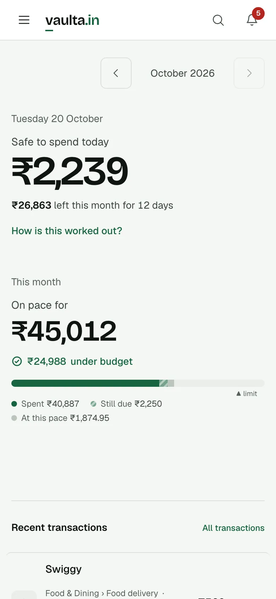
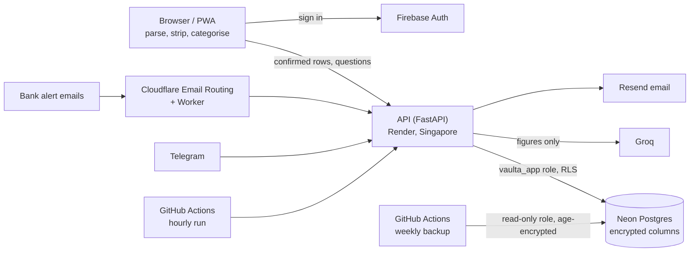

# vaulta.in

**Live: https://vaulta.in**

vaulta.in is a free, private expense tracker for India. You give it your bank, credit card or UPI-app statement once
and forward your bank's alert emails; it sorts your payments into categories, keeps you on budget, spots recurring
bills and answers questions about your money. It needs no bank login and no SMS access. Statements are read and
stripped of personal details in your browser, and the server stores each account's data encrypted with that
account's own key.

<p align="center">
  
</p>

## Features

- **Statement import, on your device:** CSV, Excel and PDF bank statements (HDFC Bank, ICICI Bank, SBI, Axis Bank,
  Kotak Mahindra Bank), credit card statements (HDFC Bank, ICICI Bank, SBI Card, Axis Bank), Google Pay, PhonePe and
  Paytm statements, any other bank's file after matching its columns once, and photos of statements.
- **Forwarded bank alerts** to a personal `in.vaulta.in` address, from 20 banks, card issuers and payment apps.
- **Categories** from your rules, your own corrections, known merchants and a small merchant model; anything unsure
  goes to a review queue. See [docs/MODEL_CARD.md](docs/MODEL_CARD.md).
- **Safe to spend today**, budgets, goals, recurring payments and price rises, people you pay and money lent, a cash
  wallet, anomalies and a yearly summary.
- **Weekly, monthly and annual reports** by email, and alerts.
- **AI chat** that answers from your own computed figures and proposes changes you confirm; also on **Telegram**
  (@VaultaAppBot), with quick expense entry.
- **Your data:** export everything (JSON and CSV), delete one import, reset your data, or delete your account.
- **Demo account** to look around without signing up. Installable as an app (PWA).

## Privacy, in short

- **Parsing in the browser.** Statement files never leave the device. Account numbers, balances, phone numbers, IFSC
  codes and personal UPI IDs are stripped before the confirmed rows are sent.
- **Per-user envelope encryption.** Descriptions, merchant names, people, notes, chats and reports are encrypted
  (AES-256-GCM) with a data key per account, wrapped by a master key kept outside the database.
- **Postgres row-level security.** The API's database role can only see the rows of the account it is working for.
- **The AI sees figures, not statements:** no raw bank narrations, references, UPI IDs or notes.

Full detail: [docs/PRIVACY-MODEL.md](docs/PRIVACY-MODEL.md) and https://vaulta.in/security.

## Tech stack

| Part | Stack |
|---|---|
| Web app | React 19, Vite 8, Tailwind CSS 3, Motion, React Router 7, Zustand; pdf.js, Tesseract.js, SheetJS, Papa Parse in the browser; PWA (vite-plugin-pwa) |
| API | Python 3.12, FastAPI, SQLAlchemy 2, Alembic, Pydantic 2, Uvicorn |
| Data | Postgres (Neon, Singapore), row-level security, AES-256-GCM field encryption (`cryptography`) |
| Services | Firebase Authentication, Groq (`openai/gpt-oss-120b`), Resend, Cloudflare Email Routing + Workers, Telegram Bot API, Google reCAPTCHA v3, Sentry |
| Hosting | Vercel (web app), Render free plan in Singapore (API), GitHub Actions (hourly run, weekly encrypted backup) |
| ML | scikit-learn for training (`ml/`); the model runs as plain JSON weights in the browser and in Python |
| Tests | pytest, Vitest, Playwright (Chromium, Firefox, WebKit, devices) with axe, Firebase Auth emulator |

## Architecture



More diagrams and the data flows: [docs/ARCHITECTURE.md](docs/ARCHITECTURE.md).

## Local development

Everything runs locally without real keys or accounts: generated encryption keys, the Firebase Auth emulator and a
fake LLM, the same setup the browser tests use. You need Python 3.12, Node 22, Postgres 16 or newer (`initdb`,
`pg_ctl` and `createdb` on your `PATH`) and Java 21 or newer (for the Firebase emulator).

```sh
git clone https://github.com/KanveerMadan/Vaulta.git && cd Vaulta

# dependencies
python3.12 -m venv backend/venv
backend/venv/bin/pip install -r backend/requirements-dev.txt
(cd frontend && npm ci)

# a throwaway local Postgres on port 54329 with a superuser "vaulta" (the tests' default)
initdb -D ~/.vaulta-pg -U vaulta --auth=trust
pg_ctl -D ~/.vaulta-pg -o "-p 54329 -c listen_addresses=localhost" -l ~/.vaulta-pg/log start
createdb -h localhost -p 54329 -U vaulta vaulta_test
```

Run the app (four terminals, from `frontend/`):

```sh
npx firebase emulators:start --only auth --project demo-vaulta --config e2e/firebase.json   # Auth emulator, :9099
../backend/venv/bin/python e2e/servers/fake_llm.py                                         # fake LLM, :8002
../backend/venv/bin/python e2e/servers/backend.py      # fresh vaulta_e2e database, migrations, demo; API on :8001
npx vite --mode e2e --port 4173                        # the app on http://localhost:4173
```

Open http://localhost:4173 and choose the demo, or sign up with any email address: the emulator prints the
verification link in its terminal instead of sending it. `backend.py`
recreates the `vaulta_e2e` database on every start. To run against your own services instead, copy
`backend/.env.example` to `backend/.env` and `frontend/.env.example` to `frontend/.env.local` and fill them in; every
variable is described in [docs/DEPLOY.md](docs/DEPLOY.md#every-variable).

## Tests

```sh
(cd backend && venv/bin/python -m pytest -q)             # API, migrations, RLS, encryption; uses vaulta_test
(cd frontend && npm run lint && npm test)                # lint and unit tests
(cd frontend && npx playwright test --project=desktop)   # browser tests, desktop Chromium; starts the four servers itself
(cd infra/email-worker && npm ci && npm test)            # email worker
```

CI (`.github/workflows/ci.yml`) runs all of these on every push and pull request, every Playwright project, the
merchant-model data check, and security checks: a secret scan of the full history, pip-audit, npm audit, Bandit,
Semgrep and an OWASP ZAP scan.

## Status

v1.0.0 launched on 2026-10-20 ([CHANGELOG.md](CHANGELOG.md)). vaulta.in is free and run by one person. The API is on
Render's free plan and sleeps when idle, so the first request after a quiet spell can take up to a minute; the app
shows "Waking up vaulta.in…" and retries.

## Docs

- [docs/ARCHITECTURE.md](docs/ARCHITECTURE.md): components, data flows, trust boundaries
- [docs/PRIVACY-MODEL.md](docs/PRIVACY-MODEL.md): what is collected, encrypted and sent to the AI; retention and deletion
- [docs/MODEL_CARD.md](docs/MODEL_CARD.md): the merchant categoriser
- [docs/DEPLOY.md](docs/DEPLOY.md): deploy flow, every environment variable, migrations, rollback, backups
- [docs/RUNBOOK.md](docs/RUNBOOK.md): what to do when something breaks
- [docs/go-live.md](docs/go-live.md): the v1.0 launch, step by step
- [docs/security/](docs/security/): threat model, encryption, row-level security, sign-in audit, MFA
- [SECURITY.md](SECURITY.md): reporting a vulnerability
- [CONTRIBUTING.md](CONTRIBUTING.md)

## Licence

[MIT](LICENSE) © 2026 Kanveer Madan
