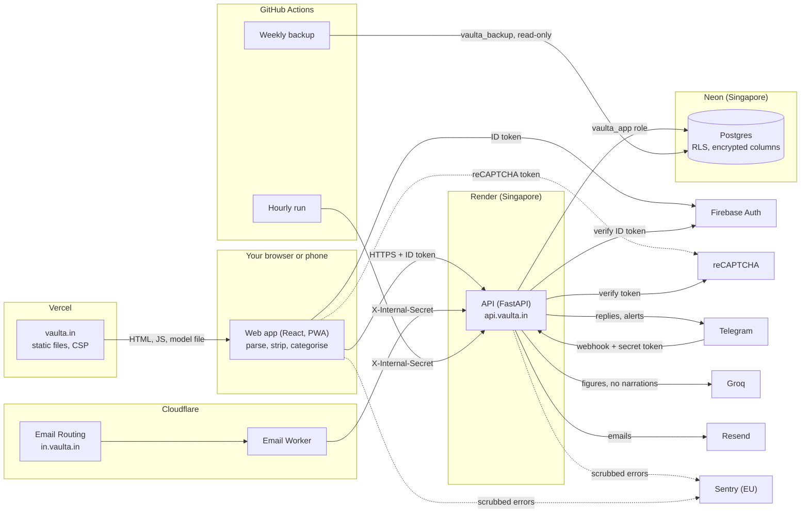
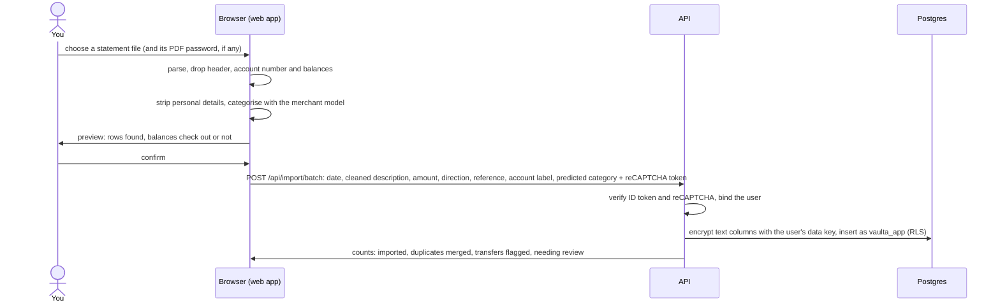
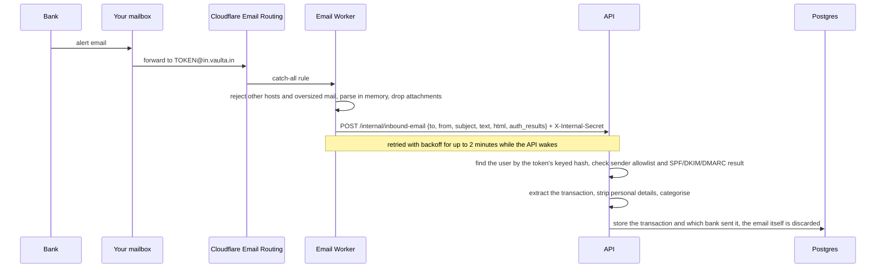
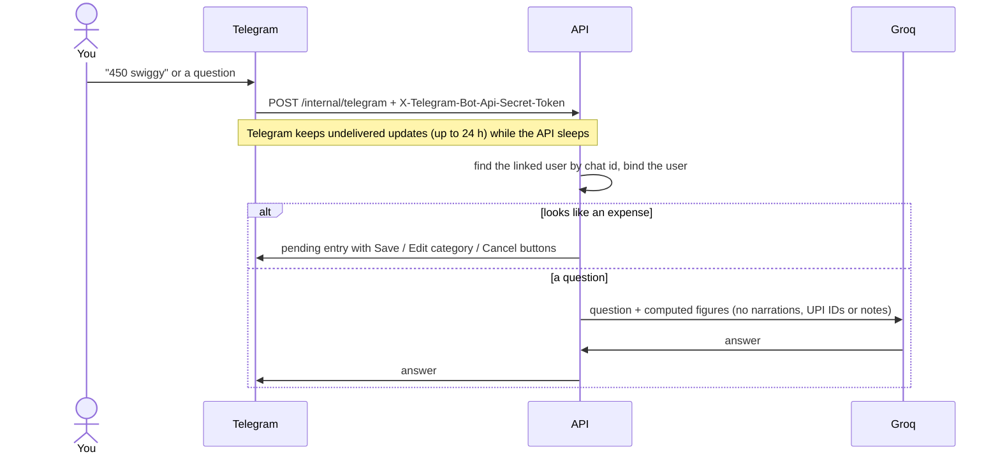
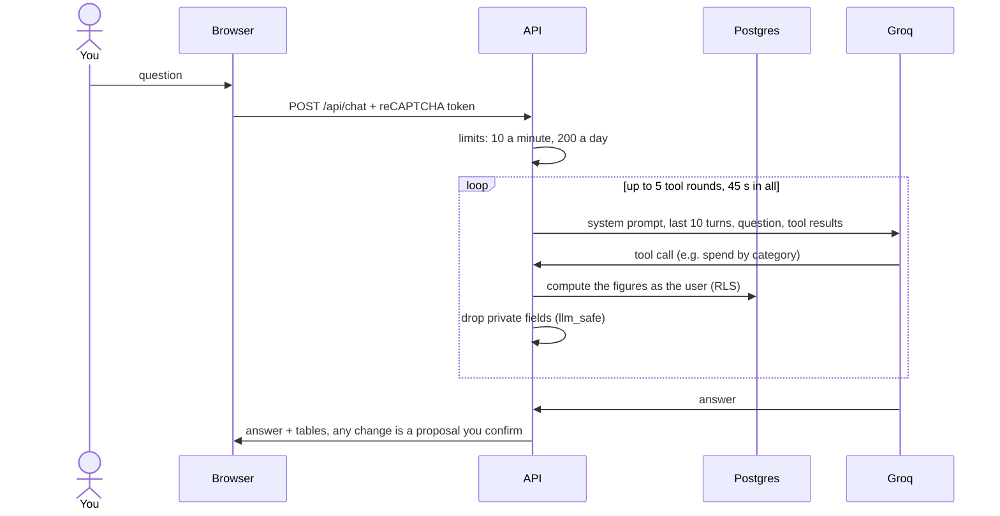

# Architecture

How vaulta.in's pieces fit together, where each one runs and where data crosses from one to the next. Setup and
every setting: [DEPLOY.md](DEPLOY.md). What is stored and who can read it: [PRIVACY-MODEL.md](PRIVACY-MODEL.md).
Threats and mitigations: [security/threat-model.md](security/threat-model.md).

## Components

| Component | What it is | Runs on | Code |
|---|---|---|---|
| Web app | React 19 + Vite single-page app and installable PWA. Parses statements, strips personal details and runs the merchant model in the browser | Vercel (Hobby), serving https://vaulta.in | `frontend/` |
| API | FastAPI on Python 3.12, SQLAlchemy, one Uvicorn worker | Render free web service `vaulta-api`, Singapore, https://api.vaulta.in. Sleeps after 15 idle minutes | `backend/` |
| Database | Postgres 18 with row-level security; the API connects as `vaulta_app` | Neon, AWS Asia Pacific (Singapore) | `alembic/` (migrations) |
| Sign-in | Firebase Authentication (Google and email). The browser signs in; the API verifies the ID token with the Firebase Admin SDK | Google | `frontend/src/lib/firebase.js`, `backend/app/core/auth.py` |
| AI | Groq's OpenAI-compatible API (default model `openai/gpt-oss-120b`) for chat and report summaries | Groq | `backend/app/services/llm.py` |
| Inbound alert email | Cloudflare Email Routing catch-all on `in.vaulta.in` and the Email Worker `vaulta-inbound-email` | Cloudflare | `infra/email-worker/` |
| Outgoing email | Resend, from `noreply@vaulta.in` (SPF, DKIM, DMARC on vaulta.in) | Resend | `backend/app/services/email.py` |
| Telegram bot | @VaultaAppBot; Telegram calls the API's webhook | Telegram | `backend/app/services/telegram_bot.py` |
| Hourly run | GitHub Actions schedule (minute 7 of every hour) that calls `POST /internal/run-reports` | GitHub Actions | `.github/workflows/hourly-run.yml`, `backend/app/services/scheduler.py` |
| Weekly backup | GitHub Actions: `pg_dump` as `vaulta_backup`, encrypted with age, kept 35 days as an artifact | GitHub Actions | `.github/workflows/weekly-backup.yml` |
| Bot checks | Google reCAPTCHA v3, verified by the API | Google | `backend/app/core/recaptcha.py`, `frontend/src/lib/recaptcha.js` |
| Error monitoring | Sentry (EU region), one project for the API and one for the web app; reports are scrubbed first | Sentry | `backend/app/core/monitoring.py`, `frontend/src/lib/monitoring.js` |
| Merchant model | Character n-gram TF-IDF + logistic regression, one JSON file used by browser and server | Browser and API | `ml/`, [MODEL_CARD.md](MODEL_CARD.md) |

Payments (Razorpay subscriptions) exist in the code (`backend/app/api/routes/payments.py`) but no payment keys are
configured in production: vaulta.in is free.

## Data flows

### Statement import

The file never leaves the device. `frontend/src/import/` reads CSV, Excel, PDF (pdf.js) and photos (Tesseract.js, run
in the browser with assets served by vaulta.in); `frontend/src/import/pii.js` strips account and card numbers, phone
numbers, IFSC codes and personal UPI IDs; the merchant model files each row. The person checks the preview, and only
the confirmed rows go to the API.

### Forwarded alert email

The person sets their mail app to forward bank alerts to their own address, `<token>@in.vaulta.in`.

### Telegram

### Chat

What exactly reaches Groq: [PRIVACY-MODEL.md](PRIVACY-MODEL.md#what-the-ai-sees).

### Hourly run and backups

The hourly workflow polls `/health` until the API is awake (up to 2 minutes), then calls `POST /internal/run-reports`.
Per user, in their timezone, that builds and emails due reports, sends alerts and the Sunday cash reminder, purges
expired samples, 30-day-old chat and rate-limit counters, finishes pending account deletions and rebuilds the demo once a
day. Re-running it is safe. The weekly backup dumps the database as the read-only `vaulta_backup` role straight into
`age` with the owner's public key; only ciphertext is uploaded.

## Trust boundaries

| Boundary | What crosses | What guards it |
|---|---|---|
| Device → Vercel | requests for static files only | HTTPS, HSTS, strict CSP (`frontend/vercel.json`) |
| Device → API | confirmed rows, questions, settings; never statement files | HTTPS; Firebase ID token on every request; reCAPTCHA v3 on demo, sign-up, password reset, import and chat; rate limits (`backend/app/core/ratelimit.py`); CORS limited to https://vaulta.in |
| API → Postgres | every read and write | the `vaulta_app` role, which can't bypass RLS; `app.user_id` bound per transaction; text columns encrypted with a per-user key ([security/row-level-security.md](security/row-level-security.md), [security/encryption.md](security/encryption.md)) |
| Cloudflare worker → API | one parsed email | `X-Internal-Secret`; only `in.vaulta.in`; sender allowlist and authentication results checked by the API |
| GitHub Actions → API | "run what's due" | `X-Internal-Secret` (a GitHub secret) |
| GitHub Actions → Postgres | a full dump | `vaulta_backup` (read-only), encrypted with age before upload |
| Telegram → API | updates from linked chats | the webhook secret token, compared in constant time |
| API → Groq | questions and computed figures | private fields removed first (`llm_safe` in `backend/app/services/chat_tools.py`) |
| Browser or API → Sentry | error type and location | scrubbers in `frontend/src/lib/monitoring.js` and `backend/app/core/monitoring.py` |
| Your machine → Postgres | migrations, key rotation | the owner role, used only from the owner's machine, never on Render |

## Cold starts

Nothing keeps the free API awake, by design (free hosting). Every caller waits for it: the web app shows "Waking up
vaulta.in…" and retries for up to 2 minutes, the hourly run polls `/health`, the email worker retries with backoff and
Telegram re-delivers pending updates. Details: [DEPLOY.md](DEPLOY.md#cold-starts-no-keep-awake).
