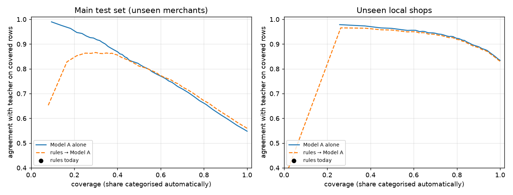
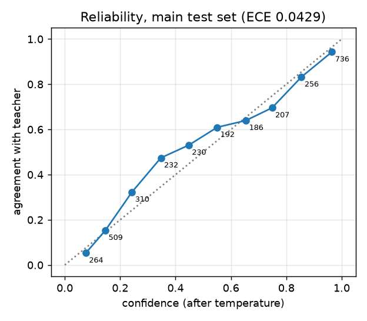
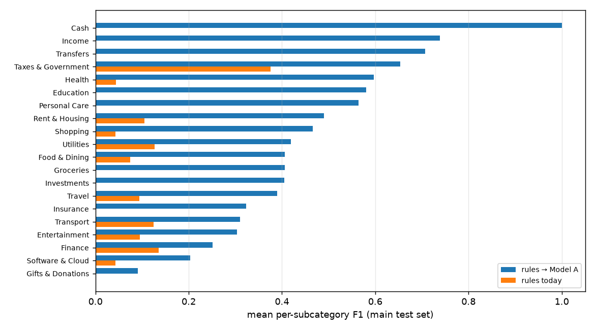

# Merchant model: evaluation

Generated by `ml/report.py` from `make train` (`ml/artifacts/metrics.json`). **This is knowledge distillation:**
labels come from LLM teachers, so every number below is *agreement with teacher labels*, not accuracy. No
human-verified labels exist yet; `ml/retrain.py` reports agreement with users' own corrections once some are
contributed (opt-in).

## Data

- Merchants: 5032 (test:brand 553, test_local:local 353, train:brand 2516, train:local 935, val:brand 535, val:local 140).
- Narrations (synthetic / real) per split: real_test 0 / 0; test 3122 / 0; test_local 1998 / 0; train 19615 / 0; val 3936 / 0. Ambiguous teacher labels are excluded.
- Teacher: A: `openai/gpt-oss-120b`, B: `qwen/qwen3.8-27b`, C: `openai/gpt-oss-20b` (A and B label every merchant name; C breaks disagreements). 5018 unique stripped merchant names; 731 came out ambiguous. A and B agreed on 3737 names. LLM calls: at least 179 (`ml/artifacts/teacher_log.json`: the first runs stopped before logging, so their count is reconstructed and leaves out refused and retried calls).
- The catalogue's own subcategory hint agrees with the teacher on 81.4% of labelled merchants (a sanity check on both; the hint never trains anything).
- Rows with no real data: `local-statements/` was empty, so the real-narrations set has 0 rows.

## Ship criteria and decision

Agreed bar: macro-F1 above today's rules on the main test set **and** on unseen local shops, and a lower
review rate at equal-or-better covered agreement. Prefer Model A unless Model B is ≥ 3 macro-F1 points better.

The shipped order is: a known merchant (the normalizer's patterns, matched on the merchant's own words, without
payment rails, banks, UPI handles, remarks or cities), then the model above its threshold, then the review queue.
The threshold is picked on validation: the rows the model files must agree with the teacher at least 90.0% there. On the main test set the shipped order's covered agreement is 84.5%, below that validation target: unseen brands are harder than the validation brands. The baseline, "rules today", is the normalizer exactly as the app runs it now.

- Model A: threshold 0.72; checks {'equal_or_better_covered_agreement_main': True, 'lower_review_rate_main': True, 'macro_f1_local': True, 'macro_f1_main': True}; **ships: True**.
- Model B: threshold 0.8; checks {'equal_or_better_covered_agreement_main': True, 'lower_review_rate_main': False, 'macro_f1_local': True, 'macro_f1_main': True}; ships: False.
- **Choice: model_a; shipped: True.**

### Two evaluation runs

The first run used today's rules unchanged as the first step of the order (patterns anywhere in the narration),
with the threshold picked so that the *whole order's* covered agreement reached 90% on validation. That was
impossible: the rules alone agree with the teacher on only 31.9% of the validation rows they file,
so the threshold went to 1.0, the model filed nothing and neither model met the bar (main test set macro-F1 7.0, the same as the rules). Most of the rules' wrong answers
were "Payment apps": the Paytm or PhonePe pattern matching a gateway, a VPA handle (`paytmqr…@paytm`) or a
remark ("Payment from PhonePe") instead of the merchant. The order was then changed as described above, from
that validation analysis; the change was made after the first run's test numbers had been seen, which is
recorded here. `ml/artifacts/metrics_run1.json` keeps the first run.

## Model A (character n-gram TF-IDF + logistic regression)

| Test set | Rows | System | Agreement | Macro-F1 | Covered agreement | Review rate |
|---|---|---|---|---|---|---|
| Main (unseen merchants) | 3122 | Rules today | 5.5% | 7.0 | 26.9% | 79.5% |
| Main (unseen merchants) | 3122 | Known merchant on its own words, no model | 5.2% | 7.4 | 65.2% | 92.1% |
| Main (unseen merchants) | 3122 | Model A alone | 32.6% | 41.9 | 88.4% | 63.1% |
| Main (unseen merchants) | 3122 | Known merchant → Model A (shipped order) | 35.6% | 44.7 | 84.5% | 57.8% |
| Unseen local shops | 1998 | Rules today | 0.2% | 0.6 | 1.5% | 86.5% |
| Unseen local shops | 1998 | Known merchant on its own words, no model | 0.2% | 0.6 | 36.4% | 99.5% |
| Unseen local shops | 1998 | Model A alone | 65.0% | 66.2 | 94.5% | 31.2% |
| Unseen local shops | 1998 | Known merchant → Model A (shipped order) | 64.7% | 66.0 | 94.0% | 31.2% |
| Real narrations | 0 | (no data) | | | | |

C = 3.0 (grid {'10.0': 0.5158, '3.0': 0.524, '30.0': 0.5021} macro-F1 on validation); vocabulary 30175 n-grams → 21542 kept, 637079 non-zero int8 weights; temperature 0.752; model file 4.3 MB as JSON. Calibration (ECE, main test set): 0.0429. Top-1 agreement with no threshold: 54.8% (main), 83.4% (local shops). Review reduction vs rules: 27.3% (main), 63.9% (local shops).

## Model B (static multilingual embedding + logistic regression)

| Test set | Rows | System | Agreement | Macro-F1 | Covered agreement | Review rate |
|---|---|---|---|---|---|---|
| Main (unseen merchants) | 3122 | Rules today | 5.5% | 7.0 | 26.9% | 79.5% |
| Main (unseen merchants) | 3122 | Known merchant on its own words, no model | 5.2% | 7.4 | 65.2% | 92.1% |
| Main (unseen merchants) | 3122 | Model B alone | 7.6% | 12.3 | 92.9% | 91.9% |
| Main (unseen merchants) | 3122 | Known merchant → Model B (shipped order) | 12.1% | 18.5 | 78.8% | 84.6% |
| Unseen local shops | 1998 | Rules today | 0.2% | 0.6 | 1.5% | 86.5% |
| Unseen local shops | 1998 | Known merchant on its own words, no model | 0.2% | 0.6 | 36.4% | 99.5% |
| Unseen local shops | 1998 | Model B alone | 16.0% | 21.8 | 95.2% | 83.2% |
| Unseen local shops | 1998 | Known merchant → Model B (shipped order) | 16.1% | 22.0 | 93.3% | 82.8% |
| Real narrations | 0 | (no data) | | | | |

`static-similarity-mrl-multilingual-v1` truncated to 128 dimensions, int8 (16.3 MB with its tokenizer); C = 10.0 (grid {'1.0': 0.3421, '10.0': 0.3809, '100.0': 0.3605}); temperature 1.2972; ECE 0.0738.

## Merchant resolution

Nearest neighbour over character 3–5-gram sets against 3100 catalogue brand names, threshold 0.81 (tuned on validation for ≥ 95% precision and ≤ 2% false resolution of local shops).
Main + local test sets: coverage of brand narrations 85.5%, precision 94.8%, local shops wrongly resolved 2.5%.

## Payments to people

500 synthetic bank narrations of payments to a person (a name, a masked UPI ID, a remark like "Rent" or "dinner"): the shipped order files 24.4% of them (Rent 121, Restaurants 1); 121 of those by the known-merchant pattern for the remark "Rent", as today's rules also do, and 1 by the model. UPI-app payments to people never reach the model (they are Sent to People), and a person's tag, when the user sets one, overrides the category.

## Plots

## Per-subcategory F1 (main test set, shipped order vs rules)

| Subcategory | Rules | Rules → Model A |
|---|---|---|
| Cash › ATM withdrawals | 0.00 | 1.00 |
| Gifts & Donations › Charity & NGOs | 0.00 | 0.09 |
| Education › Daycare & preschool | 0.00 | 0.83 |
| Education › Coaching & tuition | 0.00 | 0.47 |
| Education › College & university | 0.00 | 0.62 |
| Education › Exam & application fees | 0.00 | 0.98 |
| Education › Online courses | 0.00 | 0.00 |
| Education › School fees | 0.00 | 0.58 |
| Entertainment › Amusement & outings | 0.00 | 0.00 |
| Entertainment › Events & live shows | 0.00 | 0.38 |
| Entertainment › Fantasy sports & real-money games | 0.00 | 0.00 |
| Entertainment › Gaming | 0.00 | 0.00 |
| Entertainment › Movies | 0.00 | 0.86 |
| Entertainment › Music & audio | 0.67 | 0.88 |
| Entertainment › Video streaming | 0.00 | 0.00 |
| Finance › Bank charges & fees | 0.00 | 0.33 |
| Finance › Pay later | 0.00 | 0.00 |
| Finance › Loan EMIs | 0.58 | 0.63 |
| Finance › Payment apps | 0.10 | 0.29 |
| Finance › Money transfer services | 0.00 | 0.00 |
| Food & Dining › Bakeries & sweets | 0.00 | 0.37 |
| Food & Dining › Cafes & coffee | 0.20 | 0.75 |
| Food & Dining › Canteens & mess | 0.00 | 0.17 |
| Food & Dining › Catering | 0.00 | 0.81 |
| Food & Dining › Food delivery | 0.40 | 0.40 |
| Food & Dining › Fast food | 0.00 | 0.43 |
| Food & Dining › Restaurants | 0.00 | 0.17 |
| Food & Dining › Street food & snacks | 0.00 | 0.16 |
| Groceries › Milk & dairy | 0.00 | 1.00 |
| Groceries › Fruits & vegetables | 0.00 | 0.44 |
| Groceries › Kirana & general stores | 0.00 | 0.33 |
| Groceries › Meat & fish | 0.00 | 0.17 |
| Groceries › Quick commerce | 0.00 | 0.00 |
| Groceries › Supermarkets | 0.00 | 0.48 |
| Health › Dental | 0.00 | 1.00 |
| Health › Lab tests & diagnostics | 0.00 | 0.65 |
| Health › Doctors & consultations | 0.00 | 0.35 |
| Health › Eye care | 0.00 | 0.60 |
| Health › Fitness & wellness | 0.00 | 0.71 |
| Health › Home healthcare & vets | 0.00 | 0.00 |
| Health › Hospitals | 0.00 | 0.87 |
| Health › Pharmacy | 0.35 | 0.60 |
| Rent & Housing › Domestic help | 0.00 | 0.00 |
| Rent & Housing › Home services | 0.00 | 0.77 |
| Rent & Housing › Packers & movers | 0.00 | 1.00 |
| Rent & Housing › Property sites & brokerage | 0.13 | 0.67 |
| Rent & Housing › Rent | 0.00 | 0.00 |
| Rent & Housing › Society maintenance | 0.50 | 0.50 |
| Income › Business & freelance | 0.00 | 0.80 |
| Income › Cashback & rewards | 0.00 | 0.67 |
| Income › Refunds from government | 0.00 | 0.92 |
| Income › Interest | 0.00 | 0.86 |
| Income › Salary | 0.00 | 0.44 |
| Insurance › Other insurance | 0.00 | 0.57 |
| Insurance › Health insurance | 0.00 | 0.44 |
| Insurance › Life insurance | 0.00 | 0.60 |
| Insurance › Motor insurance | 0.00 | 0.00 |
| Insurance › Insurance platforms | 0.00 | 0.00 |
| Investments › Crypto | 0.00 | 0.00 |
| Investments › Fixed & recurring deposits | 0.00 | 0.00 |
| Investments › Gold & silver | 0.00 | 0.44 |
| Investments › Mutual funds & SIPs | 0.00 | 0.73 |
| Investments › PPF, NPS & retirement | 0.00 | 0.69 |
| Investments › Stocks & brokers | 0.00 | 0.57 |
| Personal Care › Laundry & dry cleaning | 0.00 | 0.74 |
| Personal Care › Salons & barbers | 0.00 | 0.82 |
| Personal Care › Spa & massage | 0.00 | 0.00 |
| Personal Care › Tailoring | 0.00 | 0.70 |
| Shopping › Beauty & cosmetics | 0.00 | 0.25 |
| Shopping › Department stores | 0.00 | 0.35 |
| Shopping › Electronics & appliances | 0.00 | 0.52 |
| Shopping › Eyewear | 0.00 | 0.00 |
| Shopping › Clothing & fashion | 0.00 | 0.07 |
| Shopping › Footwear | 0.00 | 0.75 |
| Shopping › Gifts & flowers | 0.00 | 0.55 |
| Shopping › Hardware & home improvement | 0.00 | 0.25 |
| Shopping › Home & furniture | 0.40 | 0.63 |
| Shopping › Jewellery | 0.00 | 0.68 |
| Shopping › Kids & toys | 0.00 | 0.48 |
| Shopping › Online marketplaces | 0.29 | 0.33 |
| Shopping › Paan & tobacco | 0.00 | 0.96 |
| Shopping › Pet supplies | 0.00 | 0.25 |
| Shopping › Sports & outdoor | 0.00 | 0.65 |
| Shopping › Watches, bags & accessories | 0.00 | 0.73 |
| Software & Cloud › AI tools | 0.00 | 0.00 |
| Software & Cloud › Cloud & hosting | 0.21 | 0.76 |
| Software & Cloud › Domains & websites | 0.00 | 0.00 |
| Software & Cloud › Productivity & work apps | 0.00 | 0.00 |
| Software & Cloud › Cloud storage & app stores | 0.00 | 0.25 |
| Taxes & Government › Fines & challans | 0.44 | 1.00 |
| Taxes & Government › Government fees | 0.00 | 0.43 |
| Taxes & Government › GST | 0.83 | 0.92 |
| Taxes & Government › Income tax | 0.60 | 0.67 |
| Taxes & Government › Property & municipal tax | 0.00 | 0.25 |
| Transfers › Credit card bills | 0.00 | 0.69 |
| Transfers › Own-account transfers | 0.00 | 0.73 |
| Transport › EV charging | 0.00 | 0.00 |
| Transport › Fuel | 0.50 | 0.69 |
| Transport › Parking | 0.00 | 0.33 |
| Transport › Metro, bus & local train | 0.00 | 0.00 |
| Transport › Cabs | 0.00 | 0.08 |
| Transport › Tolls & FASTag | 0.50 | 0.55 |
| Transport › Vehicle rental | 0.00 | 0.67 |
| Transport › Vehicle service & parts | 0.00 | 0.17 |
| Travel › Travel booking sites | 0.47 | 0.85 |
| Travel › Intercity buses | 0.00 | 0.00 |
| Travel › Flights | 0.00 | 0.19 |
| Travel › Holidays & tours | 0.00 | 0.35 |
| Travel › Hotels & stays | 0.00 | 0.55 |
| Utilities › Bill payment services | 0.00 | 0.00 |
| Utilities › Broadband & internet | 0.00 | 0.00 |
| Utilities › Electricity | 0.50 | 0.76 |
| Utilities › LPG cylinders | 0.00 | 0.50 |
| Utilities › Mobile recharge & bills | 0.39 | 0.67 |
| Utilities › Piped gas | 0.00 | 0.00 |
| Utilities › Water | 0.00 | 1.00 |

## The 50 most confident disagreements (main test set)

Synthetic narrations; "teacher" is the teacher's label for the merchant.

| Confidence | Narration | Teacher | Model A |
|---|---|---|---|
| 0.99 | `PINELABS*HOSPITAL CANT` | food.canteen | health.hospital |
| 0.99 | `TO TRANSFER-UPI/DR/XXXX/HOSPITAL CAN/ICIC/bharatpe.490/Bill` | food.canteen | health.hospital |
| 0.99 | `UPI-LEARNING-L***@ybl-XXXX-` | education.coaching | education.online_learning |
| 0.98 | `Bulk Order Biryani` | food.catering | food.restaurant |
| 0.98 | `UPI/SUGARCANE JUICE CENTRE/XXXX/` | food.street_food | food.cafe |
| 0.97 | `UPI/EYE MANTRA OPTICALS/XXXX/Payment from PhonePe` | shopping.eyewear | health.eye_care |
| 0.97 | `UPI/EYE MANTRA OPTICALS/XXXX/Payment from PhonePe` | shopping.eyewear | health.eye_care |
| 0.97 | `AMAZONPAY*ZESTMONEY` | finance.bnpl | finance.payment_app |
| 0.97 | `PCD/8325/SUGARCANE JUICE CENTRE/BLR` | food.street_food | food.cafe |
| 0.97 | `UPI/P2M/XXXX/EYE MANTRA OPTICALS/Payment/PNB` | shopping.eyewear | health.eye_care |
| 0.97 | `IMPS/P2M/XXXX/METRO CASH AN/Order` | groceries.supermarket | transport.public_transit |
| 0.95 | `UPI-CAR SPA-carspa.rzp@axisbank-XXXX-` | transport.vehicle_service | personal_care.spa |
| 0.95 | `TO TRANSFER-UPI/DR/XXXX/CHEQUE BOOK /ICIC/chequebookch/Sent using Paytm` | finance.bank_charges | shopping.books_stationery |
| 0.95 | `UPI/XXXX/EYE MANTRA OPTICALS/eyemantraopticals.rzp@axisbank/STATE BANK OF INDIA/Sent using Paytm` | shopping.eyewear | health.eye_care |
| 0.95 | `UPI/BULK ORDER BIRYANI/XXXX/Payment from PhonePe` | food.catering | food.restaurant |
| 0.95 | `UPI/XXXX/EYE MANTRA OPTICALS/Q***@ybl/AXIS BANK/Payment from PhonePe` | shopping.eyewear | health.eye_care |
| 0.95 | `UPI/XXXX/BULK ORDER BIRYANI/X***@okicici/PNB/` | food.catering | food.restaurant |
| 0.95 | `MUNICIPAL THANE` | transport.parking | taxes.government_fees |
| 0.95 | `Metro Cash And Carry` | groceries.supermarket | transport.public_transit |
| 0.94 | `UPI-SUGARCANE JUICE CENTRE-S***@ybl-XXXX-` | food.street_food | food.cafe |
| 0.94 | `TO TRANSFER-UPI/DR/XXXX/FUTURE GENER/HDFC/futuregenera/` | insurance.health | insurance.general |
| 0.94 | `POS XXXXXXXXXXXX2094 SUGARCANE JUICE CENTRE NEW DELHI` | food.street_food | food.cafe |
| 0.94 | `Apna Bazar` | groceries.kirana | shopping.marketplace |
| 0.94 | `Apna Bazar` | groceries.kirana | shopping.marketplace |
| 0.94 | `SI MANAPPURAM FINANCE 68804279` | finance.bank_charges | finance.loan_emi |
| 0.94 | `PG CCAV EYEMANTRAOPTICALS 87591991` | shopping.eyewear | health.eye_care |
| 0.93 | `BULK ORDER BIRYANI BENGALURU IN` | food.catering | food.restaurant |
| 0.93 | `NEFT-BULK ORDER BIRYAN-Paid via app-NXXXX` | food.catering | food.restaurant |
| 0.93 | `UPI/METRO CASH AND CARRY/XXXX/Pay` | groceries.supermarket | transport.public_transit |
| 0.93 | `Jiomart` | shopping.marketplace | groceries.quick_commerce |
| 0.93 | `UPI/P2M/XXXX/FREECHARGE/UPI Txn/ICICI BANK` | utilities.mobile | finance.payment_app |
| 0.93 | `IMPS/P2M/XXXX/PHARMEASY L/Paid via app` | health.diagnostics | health.pharmacy |
| 0.92 | `NEFT-GAMES24X7 LTD-UPI Txn-NXXXX` | entertainment.fantasy_sports | entertainment.gaming |
| 0.92 | `UPI/CAR SPA/XXXX/Paid via app` | transport.vehicle_service | personal_care.spa |
| 0.92 | `UPI-AQUARIUM TICKETS-Q***@ybl-XXXX-UPI` | entertainment.amusement | entertainment.events |
| 0.92 | `UPI-AQUARIUM TICKETS-X***@axl-XXXX-Bill` | entertainment.amusement | entertainment.events |
| 0.91 | `PAYU*METRO CASH AND CARRY` | groceries.supermarket | transport.public_transit |
| 0.91 | `POS XXXXXXXXXXXX7038 HOSPITAL CANTEEN PATNA` | food.canteen | health.hospital |
| 0.91 | `UPI-PHARMEASY LABS-pharmeasylabs.payu@hdfcbank-XXXX-Bill` | health.diagnostics | health.pharmacy |
| 0.91 | `UPI-FREECHARGE RECHARGE-X***@apl-XXXX-` | utilities.mobile | finance.payment_app |
| 0.91 | `UPI/LEARNING CENTRE/XXXX/` | education.coaching | education.online_learning |
| 0.90 | `NEFT-AQUARIUM TICKETS-NA-NXXXX` | entertainment.amusement | entertainment.events |
| 0.90 | `BBPS/LEARNING CENTRE/XXXXXXXX64` | education.coaching | education.online_learning |
| 0.90 | `UPI/XXXX/ZESTMONE/zestmoney.payu@hdfcbank/STATE BANK OF INDIA/Pay` | finance.bnpl | finance.payment_app |
| 0.90 | `NEFT-AQUARIUM TICKETS-UPI Txn-NXXXX` | entertainment.amusement | entertainment.events |
| 0.90 | `PARKSMART` | transport.parking | groceries.supermarket |
| 0.90 | `UPI/P2M/XXXX/AQUARIUM TICKETS/Pay/BANK OF BARODA` | entertainment.amusement | entertainment.events |
| 0.89 | `UPI/MONEYGRAM/XXXX/Payment` | finance.remittance | finance.payment_app |
| 0.89 | `UPI-FREECHARGE RECHARGE-freechargerecharge.rzp@axisbank-XXXX-Collect request` | utilities.mobile | finance.payment_app |
| 0.89 | `RZP/FREECHARGE RECHARGE/PATNA` | utilities.mobile | finance.payment_app |
